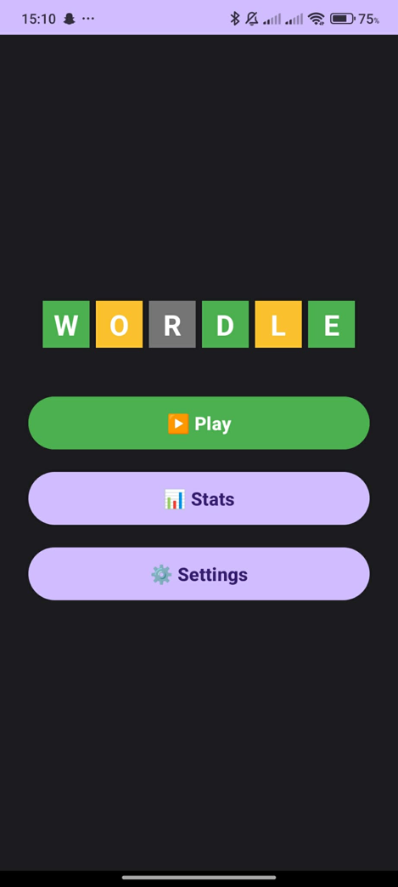
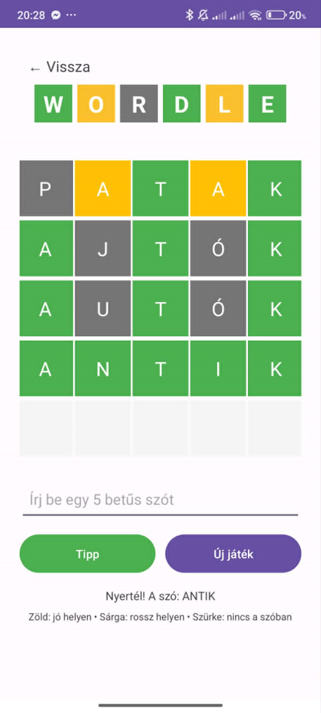
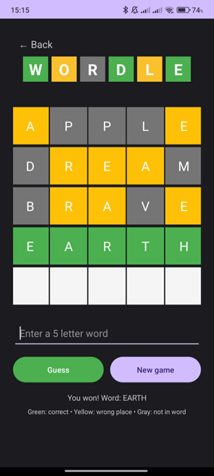
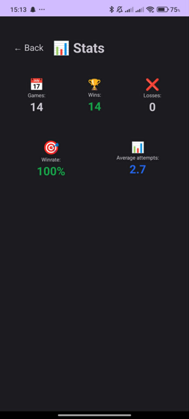
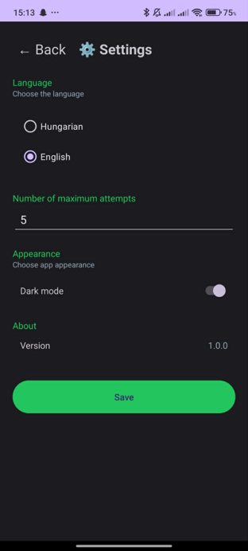

# Wordle Android Game

A native Android word-guessing game inspired by Wordle, developed in Java as part of a university mobile programming course at the University of Pannonia.

The application includes multilingual support, dark mode, configurable difficulty settings and persistent player statistics.

## Overview

The application challenges players to guess a five-letter word within a limited number of attempts. Color-coded feedback helps players identify correct letters and their positions.

## Features

- Five-letter word guessing
- Color-coded feedback
  - Green: correct letter and position
  - Yellow: correct letter, incorrect position
  - Gray: incorrect letter
- Hungarian and English language support
- Light and dark mode
- Customizable difficulty with 3–10 attempts
- Player statistics
- Persistent settings and statistics using SharedPreferences

## Screenshots

<p align="center">
  
  
  
</p>

<p align="center">
  
  
</p>

## Technologies

- Java
- Android SDK
- AndroidX
- XML Layouts
- Material Components
- Gradle
- SharedPreferences

## Project Structure

| Class | Purpose |
|---|---|
| MainActivity | Main menu |
| GameActivity | Game logic and gameplay interface |
| SettingsActivity | Application settings |
| StatsActivity | Player statistics |
| LocaleHelper | Language management |
| WordList | Game vocabulary |

## Getting Started

1. Clone the repository:

```bash
git clone https://github.com/geryyxx/PE-Wordle-Android.git
```

2. Open the project in Android Studio.
3. Synchronize the Gradle dependencies.
4. Select an Android emulator or connect a physical Android device.
5. Build and run the application.

## Learning Objectives

- Native Android application development
- Object-oriented programming in Java
- Activity lifecycle management
- Event-driven programming
- User interface development
- Application localization
- Persistent local data storage
- Game logic implementation

## Project Context

Developed as a university coursework project focused on mobile application development.

This is an independent educational project inspired by Wordle and is not affiliated with the official game.
